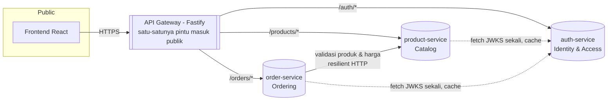

# Service Boundary Design — E-Commerce Microservices (m1.1)

Dokumen ini merancang batas layanan (service boundary) sistem e-commerce
menggunakan pendekatan **Domain-Driven Design ringan**: event storming untuk
menemukan domain event, mengelompokkannya jadi bounded context, lalu memetakan
tiap context ke satu service.

## 1. Event Storming Ringan

Langkah pertama: kumpulkan **domain event** (fakta yang sudah terjadi, past
tense) tanpa memikirkan tabel/tabel dulu, lalu kelompokkan yang "lengket" satu
sama lain.

| Domain event | Dipicu oleh | Data inti |
|---|---|---|
| `UserRegistered` | calon pelanggan mendaftar | email, password (hash) |
| `UserLoggedIn` | pelanggan login | kredensial → token |
| `TokenIssued` | login sukses | JWT RS256 (klaim: sub, role) |
| `ProductCreated` | admin menambah produk | nama, harga, stok |
| `ProductUpdated` / `ProductDeleted` | admin mengelola katalog | id produk |
| `ProductViewed` | siapa pun melihat katalog | id produk |
| `OrderPlaced` | pelanggan membuat order | item, jumlah, harga saat itu |

Pengelompokan alami (garis lengket):

- **Identity & Access**: `UserRegistered`, `UserLoggedIn`, `TokenIssued`.
- **Catalog**: `ProductCreated/Updated/Deleted/Viewed`.
- **Ordering**: `OrderPlaced` (butuh data harga/ketersediaan dari Catalog).

Ketiga kelompok inilah kandidat bounded context.

## 2. Bounded Context → Service

- **auth-service** — sumber kebenaran identitas. Menerbitkan JWT RS256 dan
  meng-expose public key lewat JWKS. Tidak tahu apa-apa soal produk/order.
- **product-service** — sumber kebenaran katalog. Memverifikasi JWT secara
  mandiri (public key dari JWKS, di-cache) — tidak memanggil auth-service tiap
  request.
- **order-service** — sumber kebenaran order. Memanggil product-service untuk
  validasi & harga saat membuat order, lewat resilient HTTP client.
- **gateway** — Backend-for-Frontend: reverse proxy, rate limit & security
  header terpusat, correlation ID, aggregated health.

## 3. Alasan Pemisahan

- **Laju perubahan berbeda**: aturan auth (keamanan) jarang berubah tapi
  kritis; katalog sering berubah; order punya logika bisnis sendiri. Memisah
  membuat tiap tim bisa deploy tanpa mengganggu yang lain.
- **Skala berbeda**: baca katalog jauh lebih sering daripada login atau buat
  order — bisa diskalakan sendiri-sendiri.
- **Blast radius**: product-service tumbang tidak boleh mematikan login.

## 4. Bagaimana Desain Ini Menghindari Tiga Anti-Pattern

**a. Distributed monolith** (service terpisah tapi saling terkunci, harus
deploy barengan):
- Tidak ada pemanggilan sinkron auth-service di setiap request. product/order
  memverifikasi token dari **public key yang di-cache** (JWKS), jadi
  auth-service bisa restart tanpa mematikan verifikasi di service lain.
- order→product memakai **resilient HTTP client** (timeout, retry, circuit
  breaker) + **graceful degradation**, jadi product-service down tidak
  membuat order-service ikut hang/crash.
- Kontrak antar-service berupa HTTP/JSON + JWKS yang stabil, bukan pemanggilan
  fungsi internal lintas modul.

**b. Nanoservice** (service terlalu kecil sampai overhead > manfaat):
- Kita berhenti di **tiga** service domain + gateway, sejalan dengan tiga
  bounded context nyata dari event storming — bukan satu service per entity
  atau per endpoint. "User", "Product", "Order" adalah kapabilitas bisnis
  utuh, masing-masing punya data & aturan sendiri.

**c. Shared database** (banyak service menulis ke DB yang sama → coupling
tersembunyi):
- Setiap service memiliki **data store-nya sendiri** (di prototype ini:
  in-memory store terpisah per service; di production: database per service —
  lihat `PRODUCTION-CHECKLIST.md`). order-service **tidak** membaca tabel
  product langsung — ia memanggil **API** product-service. Batas data =
  batas service.

## 5. Pengantar Saga Pattern (kapan async/message queue lebih tepat)

Alur `OrderPlaced` di prototype ini menyentuh dua context (Ordering + Catalog)
dan dijalankan **sinkron**: order-service memanggil product-service untuk
validasi/harga, lalu menyimpan order. Ini cukup untuk satu langkah pembacaan.

Begitu alur bisnis melibatkan **beberapa perubahan state lintas service yang
harus konsisten** — mis. `OrderPlaced` → kurangi stok (product) → buat
pembayaran (payment) → kirim notifikasi — orkestrasi sinkron jadi rapuh:
kegagalan di tengah meninggalkan sistem dalam keadaan setengah jadi, dan
memegang koneksi sinkron ke banyak service memperbesar cascading failure.

Di titik itu **Saga pattern** lebih tepat: pecah transaksi jadi rangkaian
langkah lokal, tiap langkah menerbitkan event ke **message queue**; kalau satu
langkah gagal, jalankan **compensating action** (mis. `StockReserved` →
`StockReleased`). Komunikasi async lewat queue juga men-decouple laju service
dan menyerap lonjakan beban. Prototype ini belum memakainya — message queue &
Saga penuh ada di daftar "prototype menuju production" (lihat
`PRODUCTION-CHECKLIST.md`).
